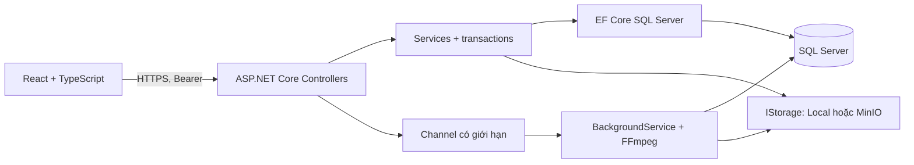

# Connectbook

Mạng xã hội portfolio với hồ sơ, theo dõi một chiều, bài ảnh, bảng tin cursor, lượt thích,
bình luận một cấp, báo cáo/kiểm duyệt và reel xử lý bằng FFmpeg. Giao diện tiếng Việt;
nội dung cộng đồng yêu cầu đăng nhập. Source giữ tên solution/namespace ConnectingBook.

## Chạy trên máy — không cần Docker

Yêu cầu: Windows, SDK hỗ trợ .NET 9, Node 22.14 trở lên tương thích Vite, SQL Server
Express đang chạy, FFmpeg/ffprobe trong PATH và chứng chỉ HTTPS localhost đã được tin cậy.
Không cần mua license cho các package hiện có hoặc SQL Server Express.
Chứng chỉ có thể kiểm tra bằng `dotnet dev-certs https --check`;
nếu chưa có/tin cậy, chủ máy tự chạy `dotnet dev-certs https --trust` khi đồng ý.

Tại thư mục gốc:

```powershell
.\scripts\Start-Local.ps1
```

Mở **https://localhost:7244**. Script build client/server, phục vụ SPA cùng origin API,
dùng Windows Authentication tới `ConnectingBookSystemDb` trên `.\SQLEXPRESS` và lưu
tệp riêng tư trong `.local/media` dưới server, không phải `wwwroot`.
Đăng ký tài khoản từ giao diện; không có tài khoản/mật khẩu mặc định trong source.
Script không tự migration; schema trong database này đã được chủ dự án cho phép áp dụng.
Khi đã duyệt migration mới, thêm `-Migrate`; không dùng thao tác reset/drop database.
Các lần chạy sau có thể dùng `-SkipBuild` nếu build chưa thay đổi.

`Jwt__SigningKey` được tạo ngẫu nhiên trong bộ nhớ nếu chưa có trong môi trường;
không ghi key xuống file hoặc log. Để giữ key qua các lần chạy, chủ máy cung cấp biến môi
trường bằng cơ chế quản lý secrets của mình. Không đưa key vào biến `VITE_*`.

## Demo riêng, không seed vào database hiện tại

```powershell
.\scripts\InitializeDemo.ps1 -Database ConnectingBook_Demo_Local
.\scripts\Start-Local.ps1 -Database ConnectingBook_Demo_Local
```

Khởi tạo hỏi email/mật khẩu qua input; mật khẩu nhập ẩn. Chỉ seed database có prefix
`ConnectingBook_Demo_` hoặc `ConnectingBook_Test_`, không seed `ConnectingBookSystemDb`.
Có Minh, An, quản trị, bài viết, theo dõi và một báo cáo chờ. Seed không lặp dữ liệu
khi database đã có tài khoản. Reel/ảnh có thể tải lên từ giao diện.
Admin đầu tiên của một database vận hành được bootstrap từ `ADMIN_EMAIL`/`ADMIN_PASSWORD`;
không có API nâng quyền, không tự nâng tài khoản Member đã tồn tại.

## Kiểm thử và build

```powershell
.\scripts\Test-Local.ps1
dotnet build Project-Web-ConnectingBook.sln
```

Test tích hợp tạo database `ConnectingBook_Test_<GUID>` riêng và chỉ xóa database do
fixture đó tạo. Không dùng SQLite/InMemory và không cần Docker. Ảnh/video test tạo cục bộ;
storage test cũng tách biệt. Không cung cấp connection string thật hoặc credentials trong báo cáo.

Chạy riêng frontend tại `project-web-connectingbook.client`: `npm ci`, `npm run build`,
`npm run lint`, `npm run test -- --run`. Phát video dùng service worker nên chạy HTTPS.
Luồng mặc định phục vụ bản React đã build cùng origin với API; Vite dev server là công cụ
phát triển riêng, cần tự cấu hình HTTPS/proxy nếu muốn dùng cookie refresh với nó.

## API

Sau đăng nhập, mở **https://localhost:7244/#docs** để dùng Swagger trong ứng dụng.
Tài liệu `/openapi/v1.json`, Swagger và assets yêu cầu Bearer; trang docs lấy token từ RAM,
không lưu localStorage, không đưa token vào URL. Chi tiết endpoint xem
[contract](specs/001-connectbook-social/contracts/api.md).

## Kiến trúc và đánh đổi



- Cursor: `(publishedAt DESC, id DESC)`; danh sách cá nhân dùng `createdAt`, bình luận
  tăng dần. SQL Server `datetime2(7)` và cursor giữ đủ tick; sửa/khôi phục không đổi vị trí.
- Đồng thời: `rowversion` cho Post và lock hàng `UPDLOCK` trong transaction. Quyết định,
  đóng báo cáo, lịch sử cùng transaction; token nhóm còn bao gồm tập báo cáo Pending.
- Tệp: storage không công khai, kiểm quyền trước ETag/Range; thumbnail kế thừa quyền.
  Endpoint chứng cứ Admin kiểm tra media thuộc report, vẫn xem được bản chụp sau xóa bài.
  Cache riêng tối đa 60 giây là độ trễ được chấp nhận sau khi ẩn nội dung.
- Reel: Channel một tiến trình; DB quyết định công việc, retry tối đa 2, phục hồi lease
  quá 10 phút. Chưa thiết kế cho nhiều replica API/worker cùng hàng đợi phân tán.
- Token: access 15 phút trong RAM, refresh 7 ngày trong cookie HttpOnly/Secure/Strict,
  server chỉ lưu hash; reuse thu hồi family. Client single-flight refresh.

## Cấu hình và chi phí

Các biến cần thiết: `ConnectionStrings__Default`, `Jwt__SigningKey`; tùy chọn
`Client__Origin`, `Storage__Provider`, `Storage__LocalPath`, `Video__FfmpegPath`,
`Video__FfprobePath`, `ADMIN_EMAIL`, `ADMIN_PASSWORD`. MinIO adapter cần thêm
`Storage__Endpoint`, `Storage__Bucket`, `Storage__AccessKey`, `Storage__SecretKey`,
`Storage__UseSsl`; bucket phải private và đã được chủ dự án cấu hình.
Không log cấu hình chứa credentials hoặc mở file secrets để chẩn đoán.

Mặc định chạy local với SQL Server Express và filesystem, không gọi API thương mại,
không tạo cloud, không bật billing. MinIO SDK Apache-2.0 khác MinIO Server AGPLv3;
FFmpeg trên máy là bản GPL. Giữ nghĩa vụ license/notice nếu phân phối binary.
.NET 9 giữ theo lựa chọn đã duyệt, dù đã hết hỗ trợ; nâng runtime cần quyết định riêng.

CI ở `.github/workflows/ci.yml` là cấu hình **chạy thủ công**, chưa được push hoặc chạy
trên GitHub. Owner kiểm tra quota/chi phí runner trước khi bật. Không có badge giả cho
một workflow chưa chạy; thêm badge thật khi owner có repository và kết quả workflow.

## Docker tùy chọn

Không cần Docker cho cách chạy/test local ở trên. `compose.yaml` là bản đóng gói demo
tùy chọn với SQL Server Developer (chỉ dev/test), API+SPA và private media volume;
MinIO là profile tùy chọn. Cần cung cấp các biến bí mật được chỉ rõ trong Compose và
chứng chỉ localhost ở `.local/https/localhost.pfx`, được tạo/xuất bởi chủ máy.
Chỉ dùng database `ConnectingBook_Demo_...` riêng. Không in `docker compose config`
khi có secrets; dùng `docker compose config --quiet`. Không dùng `down -v` để reset.
Bản Docker chưa được xác nhận chạy trong môi trường hiện tại.

## Bằng chứng kiểm chứng

### Chạy frontend bằng Vite / Visual Studio F5

Trong Development, Swagger UI độc lập mở trực tiếp tại
`https://localhost:7041/swagger/index.html` (thay cổng nếu backend dùng cổng khác),
hoặc qua Vite tại `http://localhost:5173/swagger/index.html`.
Trang có danh sách endpoint và nút **Authorize**. Dùng `POST /api/auth/login` lấy
`accessToken`, rồi nhập token vào Authorize để thử API yêu cầu đăng nhập.
Ngoài Development, Swagger/OpenAPI vẫn yêu cầu xác thực; giao diện `#docs` giữ nguyên.
Các profile backend bật `launchBrowser` và đặt `launchUrl=swagger/index.html`, nên
Visual Studio F5 tự mở Swagger. Giao diện ứng dụng vẫn ở `http://localhost:5173`.

Vite dùng `http://localhost:5173` và chuyển tiếp `/api`, `/openapi`, `/swagger`,
`/health` tới backend HTTPS. Cổng backend mặc định là `7041`; khi Visual Studio
truyền `ASPNETCORE_URLS`, Vite dùng địa chỉ HTTPS tương ứng. SPA proxy của backend
cũng dùng cổng `5173`. Sau khi đổi cấu hình, dừng và khởi động lại cả backend lẫn Vite.

Nếu backend chạy ở cổng khác, đặt biến môi trường trước khi chạy `npm run dev`:

```powershell
$env:API_PROXY_TARGET='https://localhost:7244'
npm run dev
```

Proxy kiểm tra chứng chỉ TLS; nếu có `.local/localhost-public.pem` thì chỉ dùng
chứng chỉ công khai này để xác thực backend. Không cấu hình tắt kiểm tra TLS.
Đường chạy `./scripts/Start-Local.ps1` vẫn phục vụ giao diện và API cùng cổng HTTPS.

Kiểm tra routing độc lập, không truy cập database:
`node scripts/Validate-DevProxy.mjs`. Kết quả tại
[dev-proxy.json](docs/validation/dev-proxy.json) dùng API stub tạm, không xác nhận
việc tạo tài khoản thực tế trên database của người dùng.

Kiểm tra thực tế: [video/giao diện và kiểm duyệt](docs/validation/moderation.md),
[hiệu năng bảng tin](docs/validation/performance.md). Lần đo local đạt p95 13,14 ms
với 1.000 tài khoản, 100.000 bài viết giả lập và 5 request đồng thời.

Để tự tạo SQL thêm tài khoản bằng email/mật khẩu bạn chọn, dừng debugger và chạy:

```powershell
dotnet run --project .\Project-Web-ConnectingBook.Server\Project-Web-ConnectingBook.Server.csproj --no-launch-profile -p:BuildClient=false -- --account-sql
```

Công cụ hỏi email, tên, vai trò `admin`/`user` và mật khẩu nhập ẩn; sau đó xuất SQL
để bạn tự chạy trong SSMS. Chạy riêng cho từng tài khoản. Không lưu mật khẩu rõ,
không ghi đè tài khoản đã tồn tại và không tự thực thi SQL.

Xem [báo cáo kiểm chứng](docs/validation/progress.md) và tài liệu Spec Kit tại
`specs/001-connectbook-social/`. Không coi chức năng đã viết là đã nghiệm thu nếu chưa có
kiểm tra tương ứng. Hiệu năng và video/GIF demo chỉ được công bố sau khi đo/ghi thật.
